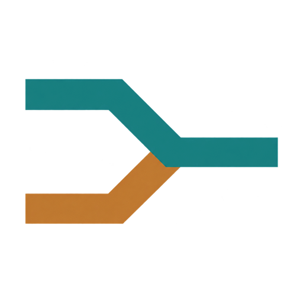

<p align="center">
  
</p>

# convergence-rig

A local CDC test rig for exact row convergence under disruption.

It replicates a PostgreSQL table to Apache Iceberg with change data capture, disrupts the source or the catalog under steady write load, and then checks that the Iceberg table holds exactly the same rows, values and schema as the source. Every run ends in an explicit verdict backed by raw evidence committed under `runs/`.

Stack: PostgreSQL 19.0, [pg2iceberg](https://github.com/polynya-dev/pg2iceberg) 0.12.0 as the CDC writer, [Lakekeeper](https://github.com/lakekeeper/lakekeeper) 0.15.1 as the Iceberg REST catalog, S3-compatible object storage, DuckDB and Apache Spark as readers, and a small Python harness. Images are pinned by digest and Python dependencies by lockfile.

## What it found

| Question | Result | Report |
| --- | --- | --- |
| Does the replica converge while PostgreSQL 19 rewrites the table with `REPACK (CONCURRENTLY)` under load? | Yes. 7 of 7 runs (3 counterbalanced pairs plus a control) matched exactly on 250,000 rows. Median write latency rose about 12 ms during the ~4.4 s rewrite, no writer was blocked, and the CDC slot's ~400 MB WAL gap drained in seconds. Plain `REPACK` blocked writers for about 4.2 s. | [M3](reports/M3.md) |
| Do two independent readers agree on a snapshot with equality deletes? | Yes. DuckDB and Spark with Iceberg returned the same snapshot ID, schema and rows. | [L1](reports/L1.md) |
| Does catalog authorization keep a reader out of a restricted table and its files? | Yes. With OpenFGA and Keycloak, the catalog hides the table (404), vended storage credentials get 403 on its files, and commits are refused. Object-level only: no row filters or column masks. | [L2](reports/L2.md) |
| What happens when the catalog goes down for 60 s? | pg2iceberg 0.12.0 in single-process `run` mode exits on the first failed catalog commit and does not recover on its own. After a restart it resumes from its slot and staging log with an exact match, leaving 2 orphan files per outage. | [L3](reports/L3.md) |

All numbers come from one Windows 11 host running Docker Desktop. Read the latency figures as observations about that host; the convergence verdicts are the result.

## How a run is judged

- The verifier in `lab/compare.py` streams both sides ordered by primary key in bounded batches and compares every column of every row: decimals exactly, timestamps as UTC microseconds, text byte for byte, JSON structurally with exact numbers. It reports missing, extra and duplicate keys before pairing rows. Fault-injection tests in `tests/` show each check failing on a deliberate defect.
- A unique marker row committed after the disruption shows when the reader sees the final state. The verdict comes from the exact comparison on that snapshot, not from the marker.
- Outcomes: `converged`, `mismatch at deadline`, `reader error`, `invalid harness run`, `REPACK failed`.

## Running it

Prerequisites: Docker with Compose and [uv](https://docs.astral.sh/uv/). Ports are bound to `127.0.0.1` and set in `compose/.env`; the credentials there are synthetic lab values.

```text
uv sync
docker compose -p cdclab --env-file compose/.env -f compose/docker-compose.yml build pg-source
uv run pytest -q
```

PostgreSQL 19.0 is built from the official release tarball, checked against its published SHA-256, because no official 19.0 image existed when the rig was built.

One matched pair (baseline, then concurrent REPACK):

```text
uv run python -m lab.m2 --seed-rows 250000 --toast-rows 25000 --duration-s 180 --rate-ops-s 10 --repack-delay-s 30 --label m2
```

Three counterbalanced pairs plus the plain REPACK control, and the report regenerated from raw runs:

```text
uv run python -m lab.m3 --pairs 3 --seed-rows 250000 --toast-rows 25000 --duration-s 180 --rate-ops-s 10 --repack-delay-s 30 --base-rng-seed 20261119 --with-plain-repack-control --label m3
uv run python -m lab.m3 --render-from-manifest <repeat_dir>/manifest.json --output-dir <repeat_dir>
```

Catalog follow-ups (build the Spark image once first):

```text
docker compose -p cdclab --env-file compose/.env -f compose/docker-compose.yml --profile spark build spark
uv run python -m lab.l1
uv run python -m lab.l2
uv run python -m lab.l3
uv run python -m lab.l3 --restart-connector-after-recovery --label l3-catalog-outage-recovery
```

Each run starts from a clean Compose project and removes only its own containers, volumes and networks.

## Layout

| Path | Contents |
| --- | --- |
| `compose/` | Compose project, pinned images, PostgreSQL 19.0 Dockerfile, pg2iceberg config, Spark and Keycloak setup |
| `lab/` | Harness: bootstrap, workload, REPACK runner and sampler, verifier, milestone runners, plots |
| `tests/` | Unit and fault-injection tests |
| `runs/` | Raw evidence for every reported run |
| `reports/` | Milestone reports with commands, versions, results and limitations |
| `docs/PLAN.md` | The plan and the pass criteria each milestone was held to |
| `drafts/` | Drafts of upstream reports |

## Limitations

- One host, one writer connection, 10 writes per second. Higher write rates may expose REPACK's brief final lock; these runs never caught a writer in it.
- pg2iceberg compaction was off in the reported runs, so equality-delete files accumulate.
- The rig checks final-state convergence. It does not check that every intermediate version reached Iceberg.

## License

Licensed under either of [Apache License 2.0](LICENSE-APACHE) or [MIT](LICENSE-MIT), at your option.
