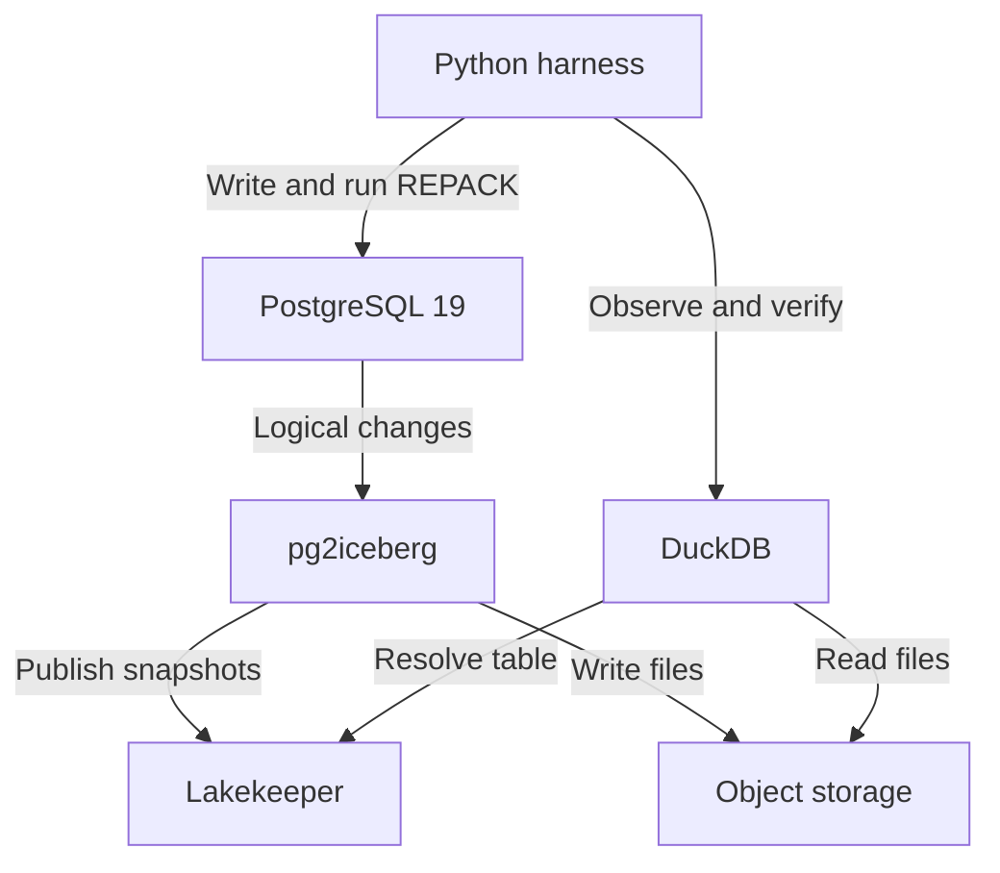

# CDC convergence lab

19 November 2026 · Andrea Bozzo

Can a PostgreSQL source table be rewritten under load while its Iceberg replica still converges to the right rows and values? Start with PostgreSQL 19, pg2iceberg, Lakekeeper and DuckDB. Use the same setup to answer a second question for future work: when does a shared Iceberg catalog solve an ingestion or data access problem well enough to justify running it?

## What to deliver

- **Weekend run.** One clean baseline, one concurrent REPACK run, and the raw evidence behind both. The report shows writer latency, reader-visible lag, time to see the final write, and the exact verification result.
- **Repeatable report.** Once the weekend run works, run three matched pairs from fresh state. Generate the results table from the raw files with a single documented command.
- **Lakekeeper follow-up.** Keep this on its own track. Start with a second reader and a scoped-access test. Add a Databricks compatibility test if Databricks is a required consumer.

Create a local Git repository at `C:/dev/cdc-convergence-lab`. Keep the repo local, use synthetic data and report suspected upstream problems as local drafts. Use an isolated Compose project, lab-owned volumes, and configurable ports bound to localhost. Reset only the lab. End each milestone with a report and a local commit. Record routine version and configuration choices in the reports and stop for a change in scope, a paid service, or access to an external environment.

## Stack

| Component | Role and setup |
| --- | --- |
| PostgreSQL 19 | Operational source. Start the core experiment with `wal_level=logical` and enough replication slots and WAL senders. PG19's default for `max_repack_replication_slots` is 5. Verify the stable 19.0 image and digest on the target architecture, or build from the official release tarball and record its checksum. |
| pg2iceberg | Initial snapshot and CDC writer. Use a pinned release, match its actual executable and config schema, and verify startup and snapshot completion from logs or coordinator state. Some settings in the public docs depend on operating mode. |
| Lakekeeper | Iceberg REST catalog. Copy the minimum services and bootstrap steps from its pinned quickstart. Give the catalog a separate metadata database so its writes stay outside the source's WAL measurements. |
| SeaweedFS | S3-compatible object storage for the local run. Recent Lakekeeper Compose examples switched from MinIO to SeaweedFS. Use the backend supplied by the pinned example and record it. |
| DuckDB | Independent downstream reader. Attach the REST catalog for the consumer smoke test. Verify the chosen DuckDB build and Iceberg extension can read the writer's equality deletes and scan by snapshot ID. |
| Python | Small harness with `psycopg`, `duckdb`, `pytest` and a locked `uv` environment. Use SQL for the reader probes and a batched ordered comparison for the final result. |

Record image tags and resolved digests, upstream release or commit, Python lockfile, DuckDB and Iceberg extension versions, effective writer settings and host details. Use storage credentials for the synthetic lab only. Test identity and credential vending separately with the catalog's authorization enabled.

[PG19 replication settings](https://www.postgresql.org/docs/19/runtime-config-replication.html) · [pg2iceberg configuration](https://docs.pg2iceberg.dev/usage/configuration/) · [Lakekeeper Compose quickstart](https://docs.lakekeeper.io/getting-started/) · [Lakekeeper release notes](https://docs.lakekeeper.io/about/release-notes/) · [DuckDB Iceberg catalogs](https://duckdb.org/docs/current/core_extensions/iceberg/catalogs)

## Correctness and timing

| Check | Evidence |
| --- | --- |
| Keys and rows | Stream both sides ordered by `id` in bounded batches. Detect duplicate IDs on the Iceberg side before pairing rows. Report source-only, lake-only and duplicate IDs with counts and up to 20 examples per category. |
| Values | Compare every column for every matched row. Preserve exact decimals without float conversion or rounding, and compare timestamps as UTC instants at microsecond precision. Compare text byte for byte in UTF-8. Parse JSON structurally with exact numbers, preserve array order, and distinguish SQL NULL, JSON null and empty text. Report differing columns and both values. |
| Schema | Check the actual Iceberg schema against an explicit mapping for the test fixture, including decimal precision and scale, timestamp semantics and required columns. Record the schema ID. |
| Reader visibility | After the workload drains and REPACK returns, commit a unique marker row to `orders`. Record when DuckDB first sees it and the Iceberg snapshot ID used. Compare that same snapshot with the now-quiescent source. Run the full diff once per eligible snapshot. If the first marker-bearing snapshot differs, keep polling distinct snapshots until equality or timeout. |
| Timing | Report final-marker commit-to-visibility, elapsed time from that commit to the first verified match, and the time spent running the diff. For steady-state reader lag, sample occasional unique marker rows in the same table and record commit-to-first-observation from the harness's monotonic clock. Report poll cadence and reader errors. |
| Pipeline positions | Record the CDC slot's `confirmed_flush_lsn` and `restart_lsn`, source WAL position, and the writer's durable staging and applied progress where exposed by the pinned release. Record the visible Iceberg snapshot ID separately. Label WAL byte gaps as such and keep them separate from reader-visible lag. |

The marker is a progress signal. Exact row and schema verification determines the verdict. Give each run an explicit outcome: converged, mismatch at deadline, reader error, invalid harness run, or REPACK failed. The lab measures final-state convergence and visibility during the run. A claim that every intermediate change arrived would require a separate event-level check.

The pg2iceberg docs describe staging before acknowledgement and application in a later materializer cycle. Use logs and available metadata, such as the snapshot's applied-log range, rather than making an HTTP metrics endpoint a dependency. Keep periodic probes small and avoid repeated full-table counts during the write-latency measurement.

[PG19 JSON semantics](https://www.postgresql.org/docs/19/datatype-json.html) · [pg2iceberg type mapping](https://docs.pg2iceberg.dev/usage/type-mapping/) · [Flusher](https://docs.pg2iceberg.dev/architecture/flusher/) · [Materializer](https://docs.pg2iceberg.dev/architecture/materializer/) · [Observability](https://docs.pg2iceberg.dev/usage/observability/)

## Milestones

### M0 · Prove the reader path

1. Start the pinned Compose project. Bootstrap the bucket, warehouse and source fixture before starting the connector. Make bootstrap safe to repeat and confirm that Lakekeeper advertises storage endpoints reachable by both containerized and host-side clients.
2. Insert two known rows and wait until DuckDB reads both. Update one and delete the other. Confirm the new value and the absence of the deleted row while the tested snapshot still references equality-delete files. Capture the snapshot ID and confirm a snapshot-pinned read.
3. Verify a fresh start and project-only cleanup. Record the exact Compose invocation, including `-f compose/docker-compose.yml` if running from the repository root.

**Pass:** The pinned versions and the insert, update and delete are all evidenced in `reports/M0.md`. A tiny insert-only success leaves this milestone open. Apache Iceberg's matrix lists PyIceberg as able to plan with equality deletes but unable to read them, so use a verified second reader, such as Spark with Iceberg, to resolve a disputed result on the same snapshot.

[DuckDB Iceberg options](https://duckdb.org/docs/current/core_extensions/iceberg/iceberg_options) · [Apache Iceberg implementation status](https://iceberg.apache.org/status/)

### M1 · Prove the checks and run the baseline

1. Implement the comparison and inject missing, extra and duplicate rows, including a duplicate with identical values. Test a last-digit difference at 38-digit decimal precision, a microsecond difference, trailing text whitespace, NULL versus empty text, semantically equal JSON with different formatting, changed JSON values and a schema mismatch. Use deterministic fixtures. Run an exact diff on a real converged table as well.
2. Seed `orders` with a bigint primary key, a mutable status, `numeric(38,9)`, `timestamptz`, text, `jsonb` and a nullable decimal. Include a few verifiably out-of-line TOAST values. Exercise both changed and unchanged TOAST values on updates.
3. Start at roughly 25,000 rows and a three-minute measured run. Pick a sustainable offered rate on the host, then hold it fixed across the pair. Generate a seeded update, insert and delete sequence and record affected rows. Wait for the initial snapshot and the warm-up marker to be visible before the measurement window.

**Pass:** Fault fixtures fail with the expected evidence. The clean baseline passes every correctness check. Preserve run evidence and commit the milestone.

### M2 · Run concurrent REPACK

1. Use the same preloaded state, workload, warm-up and measurement window as the baseline. Start `REPACK (CONCURRENTLY) public.orders` from its own autocommit connection, with a logged start, result and finish. If adding a clustering test later, name the index explicitly, such as `USING INDEX orders_pkey`.
2. Sample the REPACK backend's `pg_stat_progress_repack` phases, locks and slot activity. Record table and index size before and after. Confirm from measured transaction completion times that writes actually committed while the command was running. If the command finishes too quickly to show overlap, increase the table size for both members of the matched pair and rerun. Open the final source read transaction after REPACK finishes. PostgreSQL documents a visibility caveat for snapshots taken before the rewrite.
3. Schedule writes by offered rate. Log each write's scheduled, start and completion times, outcome and affected rows. Report p50, p99 and max scheduled-to-completed latency with sample counts, alongside execution latency, queue delay, errors, timeouts and completed throughput. Track attempted arrivals separately. A missed arrival schedule can invalidate a run. A slowdown in completions is a result. Use the REPACK interval and the matching interval in the baseline for comparisons. Report final-lock-specific figures only if the lock interval was actually observed.
4. After the final marker, verify the exact snapshot and write the results table. Distinguish evidence about CDC convergence from performance observations on this host.

**Pass:** One baseline and one REPACK run produce comparable raw evidence with a verdict and an observed overlap window. A reproducible mismatch is a result. Preserve the exact evidence and draft a minimal reproduction locally.

[PG19 REPACK command](https://www.postgresql.org/docs/19/sql-repack.html) · [REPACK progress phases](https://www.postgresql.org/docs/19/progress-reporting.html)

### M3 · Repeat and report

Run three fresh matched pairs, counterbalancing the order where practical. Keep the seed, fixture, settings and offered rate matched within each pair. Report each run, plus the median and range for this host. Add plain REPACK as a control only if it answers a remaining question. Keep plots and tables reproducible from the raw runs.

Keep the repo small: Compose and bootstrap under `compose/`, workload and checks under `lab/`, fault fixtures under `tests/`, raw evidence under `runs/`, and milestone reports under `reports/`. Provide one documented entry point for a matched pair and one for the repeated run. Record outcomes, versions, commands and limitations in the reports. Keep Dataprof out of the verifier initially so the row comparison remains a small independent oracle.

## Lakekeeper evaluation for future work

The first lab proves one writer/catalog/reader combination. The business hypothesis is that Lakekeeper can make a curated Iceberg dataset available to multiple independently operated engines with one catalog and scoped storage access. That becomes valuable when maintaining copies, distributing storage credentials or keeping readers aligned already creates work.

| Business problem | Small test and decision |
| --- | --- |
| A bronze or curated dataset needs a second consumer without another export job | Read the same snapshot through DuckDB and an Iceberg Spark client on Lakekeeper. Compare snapshot IDs, schemas and exact rows after an update and delete. If the production consumer is Databricks, rerun the test with the exact supported access route, runtime and delete format. |
| A team needs access to curated data while raw data stays restricted | In a separate authenticated run, give a writer and reader distinct identities. Put raw and curated tables in distinct storage prefixes. Verify that the reader can load and scan the allowed table, that the catalog denies the restricted table, and that the reader's vended credentials cannot fetch a known restricted object directly. Repeat on ADLS if that is the target storage. Lakekeeper authorizes at object level. Row filters and column masks need an engine or a separately materialized curated table. |
| A catalog incident blocks data availability | Take Lakekeeper offline while the source keeps accepting writes. Record whether staging continues, how much WAL or staged data accumulates, and time to the first verified match once the catalog returns. Add a metadata restore drill before proposing self-hosting for a critical workflow. Write down who owns catalog Postgres, object storage, credentials, monitoring and Iceberg file maintenance. |

**Databricks boundary.** Azure Databricks documents foreign Iceberg tables as read-only and Iceberg v2 position and equality delete files as unsupported. Its Azure catalog federation overview does not list Lakekeeper. If Databricks must read the Lakekeeper table, first verify the catalog access route in the intended workspace and then test the writer's delete format. OLake with Iceberg v3 deletion vectors is a candidate for that second test. If Databricks already owns the table and the requirement is to serve external readers, use Unity Catalog's own Iceberg REST endpoint as the baseline.

[Lakekeeper authorization](https://docs.lakekeeper.io/docs/latest/authorization/) · [ADLS storage](https://docs.lakekeeper.io/docs/latest/storage-adls/) · [Table maintenance](https://docs.lakekeeper.io/docs/latest/table-maintenance/) · [Azure Databricks catalog federation](https://learn.microsoft.com/en-us/azure/databricks/query-federation/catalog-federation) · [Azure Databricks Iceberg support and limits](https://learn.microsoft.com/en-us/azure/databricks/iceberg/) · [External Iceberg access to Unity Catalog](https://learn.microsoft.com/en-us/azure/databricks/external-access/iceberg)

## Other OSS worth testing

Change one component at a time and carry the same fixture, snapshot checks and acceptance criteria forward.

| Candidate | When it earns a test |
| --- | --- |
| **OLake Go** | First alternate CDC writer. It documents a Lakekeeper integration and configurable Iceberg delete formats, including v3 deletion vectors. Test PostgreSQL → OLake → Lakekeeper with an update and a delete if reader compatibility determines the architecture. [Lakekeeper setup](https://olake.io/docs/integrations/catalogs/lakekeeper/) · [Delete formats](https://olake.io/docs/understanding/terminologies/olake/) |
| **Apache Polaris** | First alternate catalog. Keep the writer, storage and reader as constant as possible. Compare the same read, write, denied-access and scoped-credential checks. Lakekeeper should earn its place on operational fit, interoperability or policy requirements. [Polaris and Trino](https://polaris.apache.org/guides/trino/) · [Polaris credential vending](https://polaris.apache.org/releases/1.7.0/vended-credentials/) |
| **Apache Spark with Iceberg** | Independent readback of a disputed snapshot and a practical second-engine test for catalog portability. Start it on demand. [Spark Iceberg queries](https://iceberg.apache.org/docs/latest/spark-queries/) · [Iceberg implementation status](https://iceberg.apache.org/status/) |
| **DuckLake** | Simpler option to evaluate if the actual need is a small DuckDB-led lakehouse and the Iceberg REST interface is optional. The same business fixture can be compared, but this changes the table format and catalog architecture. [DuckLake documentation](https://ducklake.select/docs/stable/) |
| **Debezium and Iceberg Kafka Connect** | Candidate when Kafka is already operated, or multiple consumers need the CDC stream independently of Iceberg. The extra components should serve that requirement. [Iceberg Kafka Connect](https://iceberg.apache.org/docs/latest/kafka-connect/) |

## Parked experiments

- **Start CDC with `wal_level=replica`.** Use a fresh source with zero logical slots. Record `wal_level` and `effective_wal_level`, then try pg2iceberg. If it refuses, use a fresh equivalent instance to demonstrate native slot creation and inspect the pinned connector's preflight. A preflight that requires `effective_wal_level=logical` before the first slot exists still blocks the clean-start case. Keep any upstream report as a draft. [PG19 logical decoding](https://www.postgresql.org/docs/19/logicaldecoding-explanation.html) · [pg2iceberg prerequisites](https://docs.pg2iceberg.dev/getting-started/installation/)
- **Schema changes and slot loss.** Reuse the harness after the REPACK result is stable. Name the operation and expected recovery policy before running the experiment. Treat a fresh snapshot after slot loss as a recovery path with its own cost and timing.

## Follow-up milestones (Lakekeeper track)

These turn "Lakekeeper evaluation for future work" into three local milestones. They reuse the M0-M3 stack, fixture, verifier and evidence rules. Databricks, ADLS and any external environment stay out of scope: stop and write `reports/BLOCKED.md` if a step seems to need one.

### L1 · Second reader on the same snapshot

1. Add Apache Spark with the Iceberg runtime as an on-demand Compose service in project `cdclab` (profile `spark`), pinned by tag and digest. Configure it against the Lakekeeper REST catalog with the same storage endpoint the other clients use.
2. On a fresh stack, seed a small fixture, run an update and a delete, and wait for the snapshot that holds them with live equality-delete files.
3. Read that snapshot ID with DuckDB and with Spark. Compare snapshot IDs, the schema and exact rows using `lab/compare.py` (Spark output fed in the same ordered, batched form). Record which Iceberg features each reader used to read the deletes.

**Pass:** both readers return the same snapshot ID, schema and rows, evidenced in `reports/L1.md`. A disagreement is a result: keep both outputs, decide which reader is wrong from the Iceberg metadata, and draft a minimal local reproduction in `drafts/`.

### L2 · Scoped access with distinct identities

1. In a separate Compose profile (`authz`), enable Lakekeeper authorization the way its pinned release documents it (identity provider and authorizer images pinned by digest). Create a writer identity and a reader identity.
2. Put a `raw` and a `curated` table in distinct storage prefixes. Grant the reader access to `curated` only.
3. Verify, with evidence for each: the reader can load and scan `curated`; the catalog denies loading `raw` to the reader; the reader's vended storage credentials cannot fetch a known `raw` data file directly from object storage; the writer can still write both. Record the exact deny responses.

**Pass:** all four checks evidenced in `reports/L2.md`, with the deny paths shown failing for the reader and succeeding for the writer. State plainly what object-level authorization does not cover (row filters, column masks).

### L3 · Catalog outage drill

1. Start the M1 baseline workload on a fresh stack. After warm-up, stop the Lakekeeper container for a fixed interval (start with 60 s) while the source keeps accepting writes.
2. During the outage, record the CDC slot positions, WAL retained, pg2iceberg's staging and applied progress from its logs and coordinator state, and any connector errors or restarts.
3. Restart Lakekeeper, commit the final marker, and measure time to visibility and to the first verified exact match. Run the full verifier.

**Pass:** an explicit outcome (converged, mismatch at deadline, reader error, invalid harness run) with the backlog and recovery timings in `reports/L3.md`. Note what a metadata restore drill and an operations owner list would need, without running a restore.

## Second round (R1, C1)

### R1 · Minimal upstream reproduction of the catalog-outage exit

Goal: a reproduction a pg2iceberg maintainer can run in a few minutes on Linux or macOS, with nothing from this lab.

1. Create `repro/pg2iceberg-catalog-outage/` with its own `docker-compose.yml`, a `pg2iceberg.yaml`, a `README.md` and one POSIX `repro.sh`. Use Compose project `p2irepro`, ports bound to `127.0.0.1` and different from the lab's. Use only public images pinned by digest: the official `postgres` image (a released major that pg2iceberg 0.12.0 supports; PG19 is not needed), Lakekeeper `v0.15.1` with its catalog database and the storage backend from its pinned minimal example, and `polynyadev/pg2iceberg:0.12.0`. No Python, no lab modules: `docker compose`, `psql` inside the Postgres container and `curl` only.
2. `repro.sh` does, printing each step with a UTC timestamp: start the stack and bootstrap; create a small table with a primary key; insert rows; wait until a snapshot exists in Lakekeeper; stop Lakekeeper; insert more rows; wait 30 s; print pg2iceberg's container state and exit code (`docker inspect`), its last log lines, and `pg_replication_slots` (`active`); start Lakekeeper; wait 30 s; print the same again. End with one line `RESULT: pg2iceberg exited with code N while the catalog was down; slot active=...` and a non-zero script exit when the reported behaviour reproduces, zero when it does not. `repro.sh down` removes only project `p2irepro`.
3. If pg2iceberg 0.12.0 documents a split mode (`stream-only` plus `materializer-only`) usable with the same config, add `repro.sh split` that runs the same steps in that mode and reports whether the materializer process survives the outage. Skip it with a note if the mode cannot be configured from the published docs or source.
4. Run `repro.sh` three times from a clean state (`down` between runs) and record each RESULT line and exit code in the report. Run it from Git Bash on this host; note anything that would differ on Linux.
5. Update `drafts/pg2iceberg-catalog-outage-exit.md` so its reproduction section points at the folder and shows the exact RESULT output. Keep it a local draft.

**Pass:** three of three runs reproduce the exit with the same RESULT line, the folder runs with nothing outside it, and `reports/R1.md` records image digests, the exact commands and outputs. If it does not reproduce outside the lab, that is a result: report what differs.

### C1 · REPACK pairs with pg2iceberg compaction enabled

Goal: repeat the M3 protocol with automatic compaction on, the way a production deployment would run, and compare with M3.

1. Find pg2iceberg 0.12.0's compaction settings and defaults in its docs and source (`target_file_size` and any thresholds or intervals). Choose settings that make compaction actually run during a 180 s window at 10 ops/s on the 250,000-row fixture; record the choice and why. Add them as a separate config (for example `compose/pg2iceberg.compaction.yaml` selected by an environment variable or flag). M0-M3 defaults and evidence must stay unchanged.
2. Run three fresh counterbalanced matched pairs with the same seeds, fixture, rate, window and REPACK timing as M3 (seeds 20261119, 20261120, 20261121; orders baseline-first, repack-first, baseline-first). Skip the plain REPACK control.
3. For each run, prove compaction ran inside the measurement window from Iceberg snapshot metadata (operation and summary of each snapshot), and report the number of compaction commits, live data files and live equality-delete files at the verified snapshot. A run in which no compaction commit happened is an invalid harness run, the same way M2 required an observed REPACK overlap.
4. Report every M3 metric for the C1 runs and a side-by-side table against M3 on the same seeds: convergence outcome, exact match, final-marker visibility, commit-to-match, diff time, steady-state reader lag, write latency in the matched interval and the full window, and pipeline positions. Say explicitly whether a compaction commit overlapped the REPACK window or the final-marker snapshot, and whether any conflict, retry or error appeared in the pg2iceberg log.
5. Generate the C1 table and the comparison from raw runs with one documented command, as M3 does.

**Pass:** six valid runs with explicit outcomes and evidence that compaction ran in each; the comparison with M3 is reproducible from raw files. A mismatch or a pg2iceberg error is a result: preserve it and draft a local reproduction.

## Third round (K1, K2, P1, W1, D1)

These deepen the Lakekeeper evaluation: what it costs to operate (K1, K2), whether it earns its place against another catalog (P1), and one parked PostgreSQL 19 question (W1). D1 tests Databricks only if credentials are provided. All reuse the M0-M3 stack, fixture, verifier and evidence rules, and must not change M0-M3, L1-L3, R1 or C1 behaviour or evidence.

### K1 · Orphan files after a catalog outage

Goal: show whether the 2 orphan files per outage that L3 found can be removed safely with Lakekeeper or standard Iceberg tooling.

1. From the pinned Lakekeeper v0.15.1 docs and API, find what it offers for table maintenance (orphan file removal, snapshot expiry, soft deletion, task queues). If it has no orphan removal, use Spark's `remove_orphan_files` procedure through the Lakekeeper catalog (the L1 Spark image), with vended or static credentials as L1 does.
2. Reproduce the L3 outage on the 25,000-row fixture with a connector restart, so orphans exist. List every object under the table's prefix and classify it: referenced by any snapshot's metadata, staging, or unreferenced.
3. Run the cleanup with an `older_than` that covers the orphans. Show it removes exactly the unreferenced files, leaves every referenced and staging object, and that the exact comparison still matches afterwards. Run it a second time while pg2iceberg is writing, with the default retention, and show no live file is removed.

**Pass:** before/after object listings with each object classified, the exact comparison passing after cleanup, and the concurrent run showing no live file removed, in `reports/K1.md`. A removed live file is a result: preserve it.

### K2 · Catalog metadata restore drill

Goal: answer the L3 design note with a real drill. What happens to CDC convergence when the catalog database is restored from a backup taken earlier in the run?

1. Under the M1 workload (25,000-row fixture, 10 ops/s), take a `pg_dump` of the Lakekeeper catalog database at a recorded time T, let pg2iceberg commit at least 3 more snapshots, then stop Lakekeeper, restore the dump into a fresh catalog database and start Lakekeeper again. Record the snapshot IDs before and after the restore, pg2iceberg's own state (`_pg2iceberg` coordinator tables, slot positions), and what object storage holds.
2. Keep the workload running and report what pg2iceberg does: errors, conflicts, re-commits, or silent continuation. Then stop writes, commit the final marker and run the exact comparison with a deadline. The outcome is one of the defined ones; `mismatch at deadline` is a valid result, with the missing or extra keys listed.
3. If the restore leaves the table behind pg2iceberg's acknowledged position, state which rows are lost from Iceberg while PostgreSQL still holds them, and test one documented recovery (for example a pg2iceberg resnapshot or a re-register) if pg2iceberg 0.12.0 offers one. Do not invent an undocumented procedure.
4. Write the operations owner list the L3 notes asked for, filled in from this drill: what must be backed up together (catalog database, object storage, pg2iceberg coordinator state) and in what order.

**Pass:** an explicit outcome with the before/after positions and the evidence in `reports/K2.md`. A loss is a result: preserve it and draft a local note in `drafts/`.

### P1 · Same checks with Apache Polaris

Goal: decide whether Lakekeeper earns its place against Apache Polaris for this setup, keeping writer, storage and readers constant.

1. Add Polaris (latest release, pinned by digest, its own catalog database) behind a Compose profile, with the same object storage. Configure a catalog equivalent to the Lakekeeper warehouse, with credential vending if Polaris supports it for this storage.
2. Repeat on Polaris: the M1 baseline (one run, 25,000 rows), the L1 two-reader check, and the L2 scoped-access checks (reader denied on the restricted table, vended credentials refused on its files, commit refused). Use Polaris's own access model; record what maps and what does not.
3. Report side by side with Lakekeeper: convergence outcome, each check, setup steps and lines of config, startup time, memory at idle and under the workload, and anything that needed a workaround.

**Pass:** each check evidenced on Polaris or explicitly reported as not supported with the documentation reference, and the comparison table in `reports/P1.md`. Lakekeeper's own results must not be re-run or changed.

### W1 · Start CDC with `wal_level=replica`

Run the parked experiment as written under "Parked experiments" (first item), on a fresh PostgreSQL 19.0 source from the lab's image. Record `wal_level` and `effective_wal_level` before and after the first logical slot exists, and what pg2iceberg 0.12.0's preflight does. If pg2iceberg refuses, show native slot creation working on an equivalent fresh instance and quote the preflight code at the pinned commit.

**Pass:** the outcome with the exact settings, the preflight behaviour and the source reference in `reports/W1.md`; a local draft in `drafts/` only if pg2iceberg rejects a configuration that PostgreSQL 19 supports.

### D1 · Databricks Free Edition, only with credentials

Run D1 only if `compose/.env.local` defines `DATABRICKS_HOST`, `DATABRICKS_TOKEN` and `DATABRICKS_CATALOG`. If any is missing, write `reports/D1.md` saying D1 was skipped for missing credentials, and stop. Never print, log or commit the token, and never write it to any file except where it already is.

1. Work only inside the given catalog, in one schema named `convergence_rig`. Create nothing else and change no workspace or metastore setting; if a step needs one (for example enabling external data access), stop and report it.
2. Feasibility first: from the host, load Unity Catalog's Iceberg REST configuration (`/api/2.1/unity-catalog/iceberg-rest`) with the token, and record what the workspace allows (credential vending, write access for external engines to managed Iceberg tables).
3. If external writes are allowed, run pg2iceberg 0.12.0 against Unity Catalog's Iceberg REST endpoint with the M1 workload on the 2,500-row fixture for 60 s, then verify the exact comparison by reading the table back with DuckDB through the same endpoint. If only reads are allowed, create a small managed Iceberg table in Databricks with synthetic rows and verify that DuckDB and Spark read it exactly through the endpoint.
4. Drop every table you created except one: leave a single small synthetic table named `orders_demo` (at most 1,000 rows, the same columns as the lab fixture) in schema `convergence_rig`, readable from the Databricks UI, for a demo. List what was dropped and what was kept. The catalog name `convergence-rig` contains a hyphen: quote it with backticks in SQL.

**Pass:** the feasibility answers and either an exact comparison or a precise statement of what blocked it, in `reports/D1.md`, with no credential in any committed file.
